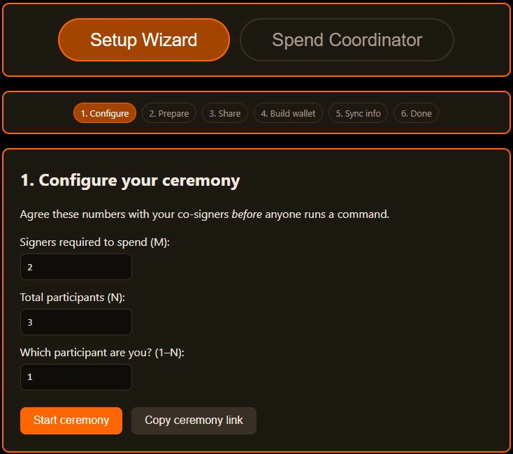
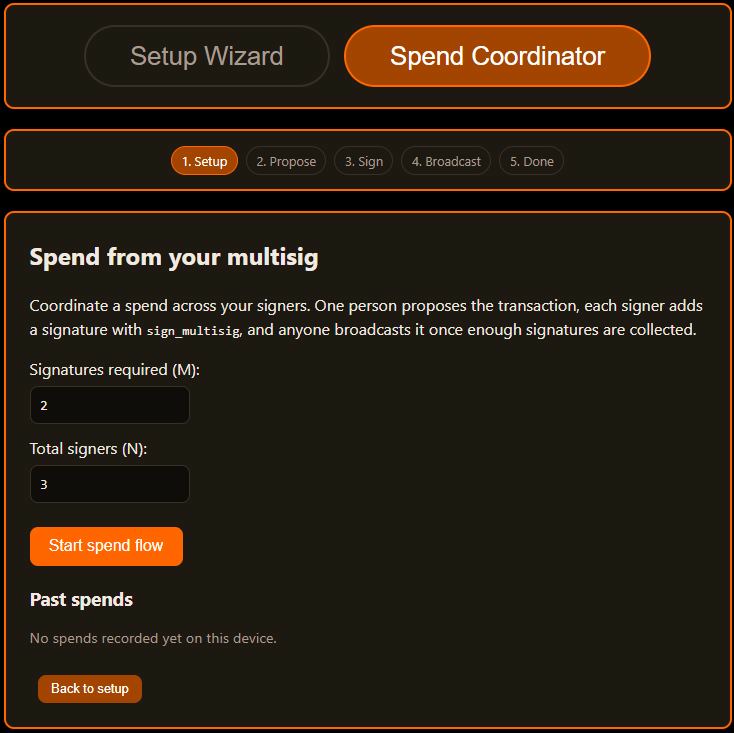
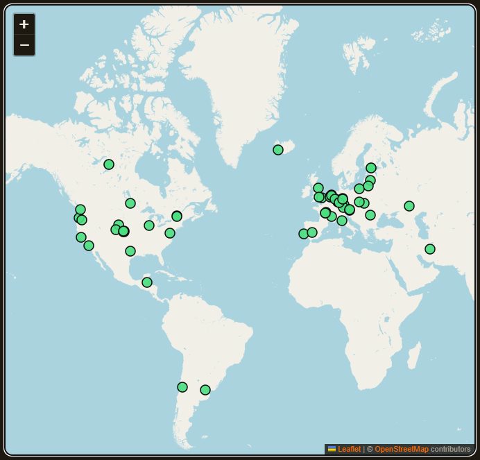

<p align="center">
  <a href="https://xcheesedev.github.io/xmr-wizard/">
    
  </a>
</p>

# XMR Wizard

A free, stateless hub for Monero: set up a multisig wallet step by step, coordinate spending as a group, and find a fast public node — without ever touching your keys.

**Live and functional at [xcheesedev.github.io/xmr-wizard](https://xcheesedev.github.io/xmr-wizard/)** — deployed via GitHub Pages.

## The problem

Monero has supported multisig wallets for years — shared custody, 2-of-3 escrow, DAO treasuries — but almost nobody uses it, because the setup is a CLI obstacle course: `prepare_multisig`, swapping hex strings between participants in the right order, `make_multisig` with the right threshold, then multiple rounds of `export_multisig_info` / `import_multisig_info`. One string pasted wrong and you're debugging blind. The GUI wallet doesn't support multisig at all.

## What this does

This page coordinates the ceremony, participant by participant:

1. **Configure** — agree on M-of-N and who is who, before anyone touches the CLI. A shareable ceremony link encodes the numbers so co-signers open the page with everything pre-filled.
2. **Prepare** — each person runs `prepare_multisig`; the page validates the `MultisigV1...` output.
3. **Share** — the page shows exactly what to send the other participants, with a copy button and a scannable QR code for phone-to-phone sharing.
4. **Build** — paste the co-signers' strings, get the exact `make_multisig` command to run.
5. **Sync** — loop `export_multisig_info` / `import_multisig_info` rounds until every wallet reports the setup complete.
6. **Verify** — every participant pastes their final wallet address; the page confirms all addresses are identical before anyone funds the wallet.

<p align="center">
  
</p>

The **Node Hub** (`nodes.html`, merged from xmr-niblet) finds you a fast public node:

- The page auto-tests on load: every node is pinged 3 times from your browser and ranked by median latency. A spinner shows while the test is running.
- The list shows the 10 fastest healthy-synced responders first, with a **Show all N nodes** toggle for the full list. Health comes from an hourly automated check (`status.json`: block height, version, reachability) so a fast-but-dead node never tops the ranking.
- Filter chips (All / Clearnet / Tor / I2P) and a Hide-offline checkbox narrow the list and map.
- The map plots nodes colored by health, with a popup + copy button per node. Each list row has a **Show on map** button linking the two views.
- A custom-node tester lets you check any host:port not on the list.
- It is linked from the homepage Nodes box ("See Node Map"). Niblet, the rice-ball node manager, watches over the node section.

The **Spend coordinator** tab handles life after setup, signer by signer:

1. **Setup** — agree on M-of-N for this spend.
2. **Propose** — one participant creates the transaction in `monero-wallet-cli`, adds the first signature with `sign_multisig`, and enters the amount + destination address on the page.
3. **Sign** — each remaining signer loads the transaction file, adds their signature with `sign_multisig`, and marks themselves signed; the page counts signatures toward the threshold.
4. **Broadcast** — once enough signatures are collected, anyone broadcasts with `submit_multisig`.
5. **Done** — the transaction is on the network, and the spend is saved to the local history (amount, address, date) on the start screen.

<p align="center">
  
</p>

## Node Hub

<p align="center">
  <a href="https://xcheesedev.github.io/xmr-wizard/nodes.html"></a>
</p>

Find the fastest, healthiest Monero remote node for *your* connection. A static, stateless page: every node is latency-tested from the visitor's own browser and ranked by speed, with health data (synced / behind / offline) from an hourly automated check, plus a copy button for pasting the address into a wallet.

<p align="center">
  
</p>


### Adding a node

Pull requests welcome. Add an entry to `nodes.json`:
<h3><a href="https://github.com/xCheeseDev/xmr-wizard/edit/main/nodes.json" target="_blank" rel="noopener noreferrer">Add your node here via Pull Request!</a></h3>


```json
{
  "host": "node.example.com",
  "port": 18089,
  "network": "clearnet",
  "operator": "Your name / org",
  "region": "City, CC"
}
```

- `network`: `"clearnet"`, `"onion"`, or `"i2p"`
- `port`: `18089` is the standard restricted RPC port for public nodes
- `tls`: set `true` only if the node serves RPC over HTTPS
- `operator`: who runs it (optional but encouraged)
- `region`: rough location, helps visitors pick nearby nodes (optional)
- `lat` / `lon`: coordinates for the map, geocoded from `region` (optional;
  maintainers add them when a node is listed)

Please only list nodes you run or that are publicly advertised by their
operator. The hourly check automatically flags entries that stop responding.

## Safety model

Fully stateless. No server, no accounts, no analytics. The multisig wizard makes no network calls at all; the node hub necessarily probes nodes from your browser and loads the map (Leaflet + OpenStreetMap tiles). The page never sees or asks for private keys or seed phrases — it only handles the public coordination strings that participants are supposed to share with each other anyway. Pasted CLI outputs are shape-checked (correct prefix, one unbroken line, hex body, sane minimum length) to catch copy-paste mistakes early. All cryptography happens in your own `monero-wallet-cli`. The ceremony isn't saved — every visit starts fresh. Only your spend history is kept in your browser's local storage (clear it from the Spend tab).

## Run it

No build step. Open `index.html` in a browser, or serve the folder:

```sh
python3 -m http.server 8000
# then open http://localhost:8000
```

## Status

Early development. The CLI command mapping in `app.js` follows the documented `monero-wallet-cli` multisig flow, validators check shape (MultisigV1 prefix, unbroken hex body, 128+ character minimum) — exact output shapes vary between Monero releases and still need checking against real CLI output. If you've done a Monero multisig setup by hand, that verification is the most valuable contribution right now.

## Contributing

Keep it stateless. The only vendored dependency is the QR code renderer (qrcode-generator, MIT). The map loads Leaflet from a CDN (the one exception) plus OpenStreetMap tiles. Any feature that would require a server, an account, or handling private key material is out of scope by design.

## Coming soon — Premium

A separate Premium section is on the way.<br>
Ceremony Rooms — a private room keeps your group's multisig ceremony on track across days: it holds only the public coordination strings, validates each paste, and shows whose turn it is.<br>
Payment Proof — prove an XMR payment happened. Paste a transaction ID, transaction key, and recipient address, and get a receipt.<br>
Premium will be paid in XMR, with no accounts. The only reason it costs money is to pay for the backend needed to run these features. It stays off until the site moves off GitHub Pages, since rooms and verification need a small backend. The free wizard stays free and stateless.

<p align="center">
  
</p>
